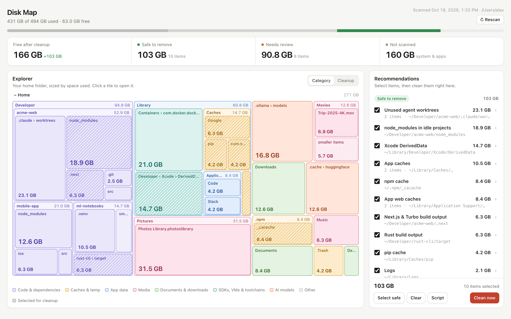

# Disk Map

**See what's filling up your Mac, and clean it up from your browser.**

Disk Map scans your home folder, draws a treemap of where the space went, and lists what's
safe to remove: stale `node_modules`, build output, package caches, Xcode DerivedData, unused
agent worktrees, and more. Tick what you want gone, press **Clean now**, and watch the space come back.

One Python file, no dependencies, runs entirely on your machine.

<picture>
  <source media="(prefers-color-scheme: dark)" srcset="docs/screenshot-dark.png">
  
</picture>

<sub>Screenshot from a demo home folder.</sub>

## Quick start

```bash
git clone https://github.com/meetshukla/disk-map.git
cd disk-map
python3 diskmap.py
```

The first scan takes a few minutes on a full disk. When it's done, Disk Map opens at
<http://127.0.0.1:8777>.

| Command | What it does |
|---|---|
| `python3 diskmap.py` | Scan, then open the app |
| `python3 diskmap.py --serve` | Open the app on the last scan (no rescan) |
| `python3 diskmap.py --render` | Write a static `disk-map.html` you can open without a server (it builds a cleanup script instead of cleaning) |
| `--port 8777` | Use a different port |
| `--no-open` | Don't open the browser automatically |

**Needs:** macOS and Python 3.8 or newer (the one that ships with Xcode Command Line Tools is fine).

## What you get

- **Explorer.** Your home folder as a treemap. Click a tile to zoom in. Switch between
  coloring by *Category* (code, caches, media, AI models…) and by *Cleanup* (what's selected).
- **Recommendations** in two groups:
  - **Safe to remove.** Things that come back on their own: package caches (npm, pip, Yarn, Bun,
    pnpm, Cargo, Gradle), `node_modules` in projects you haven't touched in 30+ days, `.next` and
    `.turbo` output, Rust `target/`, Xcode DerivedData, app and browser caches, logs.
  - **Needs review.** Things you might still want: `node_modules` in active projects, Python
    virtualenvs, Docker and Colima data, iOS simulators, Ollama, Hugging Face and LM Studio models,
    iPhone backups, installers, and any other file over 1 GB.
- **Clean now.** Deletes the selected items and shows the progress live. You can also press
  **Script** to get the same cleanup as a shell script you can read and run yourself.
- **Rescan** whenever you like, right from the page.

## Agent worktrees

If you use Claude Code, Codex or Conductor, old git worktrees pile up quickly. Disk Map only
offers to remove a whole worktree when nothing can be lost: it has no uncommitted changes,
everything is pushed, it's been idle for 2+ days, and no Claude or Codex chat ever ran in it.
Those are removed with `git worktree remove`, so their branches stay in the repo.

Worktrees that fail any of those checks are kept so their chats can still be resumed. Disk Map
only offers to clear their `node_modules`.

## Is it safe?

Disk Map is built so it can't surprise you:

- **Nothing is deleted until you press *Clean now* and confirm.** Scanning is read-only.
- **It only deletes paths from its own recommendation list**, and only inside your home folder.
  Top-level folders (Documents, Desktop, Downloads, Pictures, Library…) are never deleted as a whole.
- **Some things are never touched**, whatever the rules say: `~/.ssh`, `~/.config`, editor
  settings, installed toolchains (`~/.nvm`, `~/.rustup`, `~/.cargo/bin`…), and Claude/Codex chat history.
- **Nothing in use is deleted.** Right before each delete, Disk Map runs `lsof` and skips any
  item a running process has a file or its working folder in: an MCP server launched with `uvx`
  from `~/.cache/uv`, an open app's cache, an update mid-install. It shows as *skipped: in use
  by …*; quit the app and clean again. `~/Library/Logs` is the exception, since deleting an open
  log file is harmless. The list marks in-use items so you know before you press *Clean now*.
- **Tools clean their own data.** Docker, Colima and simulators are cleaned with their own
  commands (`docker system prune`, `colima delete`, `xcrun simctl delete unavailable`) rather
  than by deleting their folders.
- **It's local only.** The server listens on `127.0.0.1`, checks the request origin, and
  needs a per-session token for every action. Nothing leaves your machine.

Items in **Needs review** really do need a look. A model you'd have to re-download over a slow
connection, or a video that exists nowhere else, are the reasons that group exists.

## How it works

`diskmap.py` runs `du -k -x ~` and `find ~ -size +1G` in parallel, keeps every folder of 20 MB or
more, and saves the result to `scan.json` next to the script. It then matches known patterns
(caches, build output, dependency folders, model stores) to build the recommendations,
checks git state for worktrees, and serves `template.html` with the data embedded.

Sizes are what `du` reports. APFS clones and snapshots mean the space you actually get back
can be a little less than the number shown.

## License

MIT
